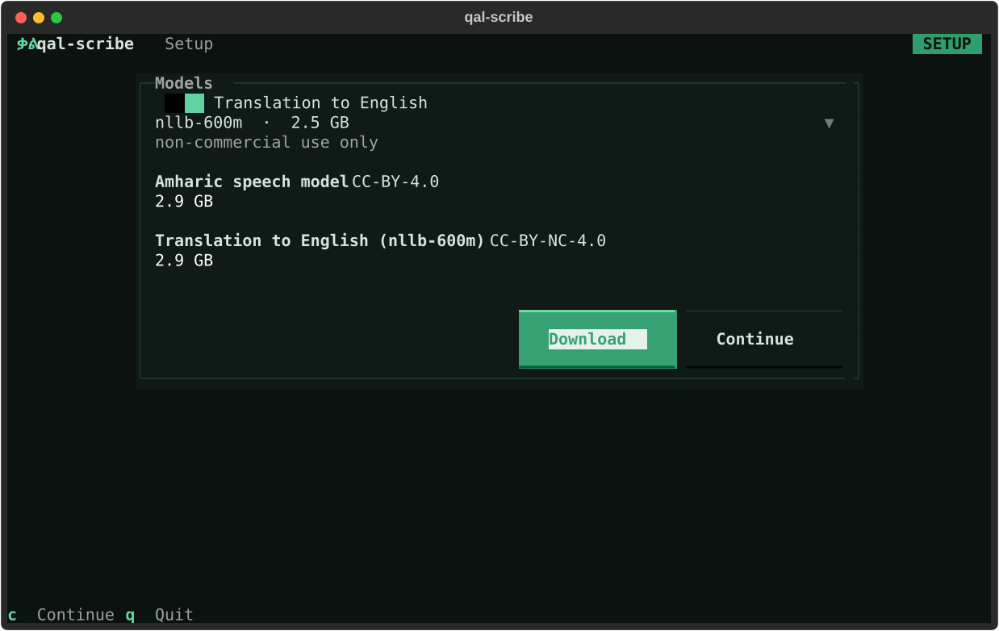

# Permissions

qal-scribe listens to your microphone, watches for its keys while another app is in front, and pastes into that
app. Your operating system asks you to allow each of these. The setup screen (`qal-scribe setup`, or `d` in the
window) shows what is missing and helps you turn it on.



## macOS

macOS gives these permissions to the **terminal app** you run qal-scribe from (Terminal, iTerm2, Ghostty,
WezTerm, VS Code, ...), not to qal-scribe itself. All three are in **System Settings > Privacy & Security**.

| Permission | Why | Without it |
|---|---|---|
| **Microphone** | to hear you | macOS gives the terminal silence instead of your voice |
| **Input Monitoring** | so the push-to-talk keys work while another app is in front | the keys do nothing |
| **Accessibility** | to paste the text into that app | the text is not pasted (it is still in the history) |

On the setup screen:

1. Press **Open Settings** next to a permission. The first press asks macOS, which also adds your terminal to
   that list. If macOS shows a prompt, allow it.
2. If the switch is still off, press **Open Settings** again: it opens the right pane. Turn your terminal on.
3. When all three are on, **quit the terminal with ⌘Q** and open it again. macOS applies some of these only to
   a freshly started app; until then the Input Monitoring row says "restart (your terminal) to finish".

The microphone row says "not asked yet" until you first record: macOS asks then. If you once said no, macOS
does not ask again, so turn it on in the Microphone pane instead.

To check from the command line: `qal-scribe doctor`.

## Linux

Linux asks for no permissions, but qal-scribe needs a few system pieces. The setup screen lists them under
**Your system** with the install command for your distribution (press `y` to copy it).

| Check | What it needs | Install (Debian, Ubuntu; the setup screen shows yours) |
|---|---|---|
| **Microphone** | PortAudio, and a running audio server | `libportaudio2` (Debian, Ubuntu) or `portaudio` (Fedora, Arch); `systemctl --user start pipewire pipewire-pulse` if the audio system is unavailable |
| **Text insertion**, X11 | `xdotool` and `xclip` | `sudo apt install xdotool xclip` |
| **Text insertion**, sway, Hyprland | `wtype` | `sudo apt install wtype` |
| **Text insertion**, GNOME, KDE Wayland | `ydotool` and `wl-clipboard`, with `ydotoold` running | `sudo apt install ydotool wl-clipboard` |
| **Hotkeys**, Wayland | a key binding in your desktop settings | see below |

Without a text tool, qal-scribe still works: the text goes to the clipboard and the window says so. On GNOME and
KDE Wayland the text is pasted with Ctrl+V, which terminals do not accept, so pasting into a terminal does not
work there.

**Wayland hotkeys.** Wayland does not let programs read global keys. Bind two keys in your desktop or compositor
settings to these commands:

```sh
qal-scribe toggle              # first press starts recording, second press pastes Amharic
qal-scribe toggle --translate  # the same, pasting English
```

**Reinstalling** qal-scribe needs the build tools for its keyboard library: `build-essential python3-dev`
(Debian, Ubuntu), `gcc python3-devel kernel-headers` (Fedora) or `base-devel` (Arch).
