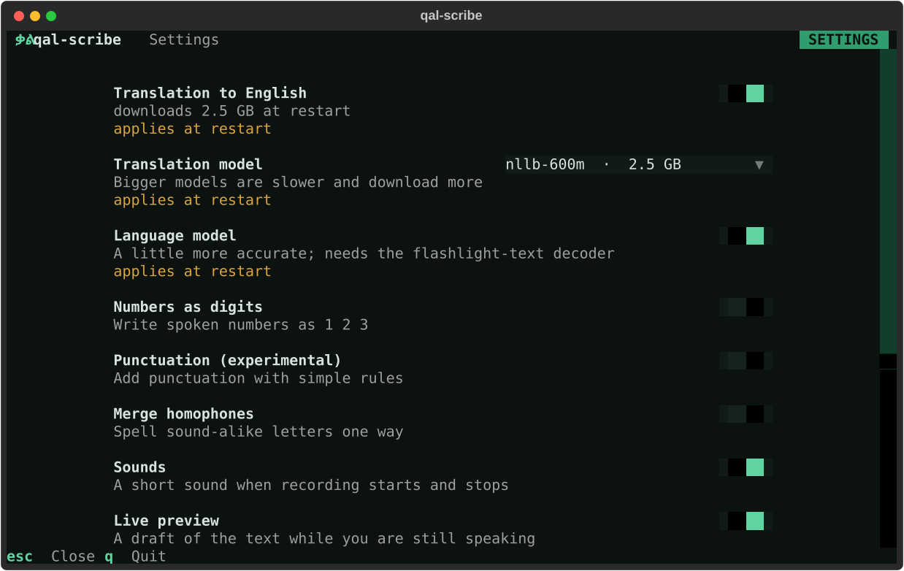

# Settings

Press `s` in the qal-scribe window to change the common settings. Each one saves the moment you change it;
the ones marked "applies at restart" take effect when you press `r` there or start qal-scribe again.



All settings live in `config.toml`, in `~/.config/qal-scribe/` (or under `$XDG_CONFIG_HOME`).

```sh
qal-scribe config           # print where the file is
qal-scribe config --init    # write a commented copy listing every setting with its default
qal-scribe doctor           # check the file after editing it
```

In the file, every line starts commented out. Remove the leading `# ` from a line to change that setting.

## Every setting

**Speech**

| Setting | Default | What it does | In `s` |
|---|---|---|---|
| `language` | `"amh"` | which language to dictate; `qal-scribe models` lists them | no: press `l` |
| `lm` | `true` | decode with the speech model's language model: a little more accurate. `false` is plain greedy decoding | at restart |
| `device` | fastest available | where the model runs: `"mps"` (Apple GPU), `"cuda"` or `"cpu"` | no |
| `mic` | system default | part of a microphone's name (`"MacBook Pro Microphone"`) or its number | at restart |
| `preview` | `true` | show a live draft of the text while you are still speaking | live |

**Keys**

| Setting | Default | What it does | In `s` |
|---|---|---|---|
| `dictate_key` | `"alt_r"` (Right Option) | hold to record, release to paste the text | at restart |
| `translate_key` | `"cmd_r"` (Right Command); Linux `"ctrl_r"` (Right Control) | hold to record, release to paste English. `""` turns this key off | at restart |

Key names are [pynput names](https://pynput.readthedocs.io/en/latest/keyboard.html#pynput.keyboard.Key) such as
`alt_r`, `cmd_r`, `ctrl_r`, `shift_r`, `alt_l` or `f13`. In the settings screen, press the key button and then
the key you want.

**Translation**

| Setting | Default | What it does | In `s` |
|---|---|---|---|
| `translation` | `true` | `false`: no translate key, and the translation model is never downloaded or loaded (saves 2.5 GB of disk and memory). `qal-scribe --no-translate` does the same for one run | at restart |
| `translation_model` | `"nllb-600m"` | `"nllb-600m"` (2.5 GB), `"nllb-1.3b"` (5.5 GB). Bigger is slower; both are for non-commercial use only | at restart |

**Text clean-up** (made for Amharic)

| Setting | Default | What it does | In `s` |
|---|---|---|---|
| `numbers_to_digits` | `false` | write spoken numbers as digits: ሁለት ሺህ አስራ ሰባት → 2017 | live |
| `merge_homophones` | `false` | spell sound-alike letters one way: ሐ ኀ → ሀ, ሠ → ሰ, ዐ ዓ → አ, ፀ → ጸ | live |
| `punctuation` | `false` | add ። ? and ፣ with simple rules. Experimental, see below | live |
| `words_file` | `words.txt` in the config folder | your own corrections, see below | no |

**Pasting and the window**

| Setting | Default | What it does | In `s` |
|---|---|---|---|
| `restore_delay` | `0.5` | seconds before your clipboard is put back after pasting. Raise it if an app pastes your old clipboard instead | no |
| `sounds` | `true` | short sounds when recording starts, stops or fails. `v` on the main screen mutes them | live |
| `indicator` | `true` | macOS only: a small floating pill at the bottom of the screen, "Listening" while you hold the key and "Transcribing…" after, even when the terminal is hidden. It never takes focus. Ignored on Linux | no |
| `check_updates` | `true` | once a day at start, ask PyPI whether a newer qal-scribe is out and say so (`qal-scribe update` installs it). Sends nothing about you; offline it stays quiet | no |
| `theme` | `"qal"` | colours: `qal`, `qal-light`, or a built-in Textual theme such as `nord`, `gruvbox`, `dracula`, `tokyo-night`. `t` in the window cycles them | live |
| `compact` | `false` | a 3 to 5 line strip for a small, always-visible window. `m` toggles it for now | live |

## Your own words

Put corrections in `words.txt` in the config folder, one per line:

```
# heard => wanted
ኤፒአይ => API
```

Lines starting with `#` are ignored. The wanted text still goes through `merge_homophones` and
`numbers_to_digits` when those are on, so a wanted word containing ዓ or a number word can change; turn those
off if that happens.

## Punctuation (experimental)

Amharic speech models write no punctuation. With `punctuation = true`, qal-scribe adds it by rule: ? after a
sentence with a question word (ምን, ማን, የት, መቼ, እንዴት, ስንት, ...), ። otherwise, and ፣ before ነገር ግን, ሆኖም and
ምክንያቱም. The rules prefer a missing mark to a wrong one, but they do make mistakes: an exclamation such as
እንዴት ደስ ይላል gets ?, and a yes/no question without a question word (ዛሬ ትመጣለህ) gets ።. Check the text before you
send it.

Spoken numbers have traps too: አንድ ("a", "one") becomes 1 in አንድ ቀን, and the city አርባ ምንጭ becomes 40 ምንጭ.
